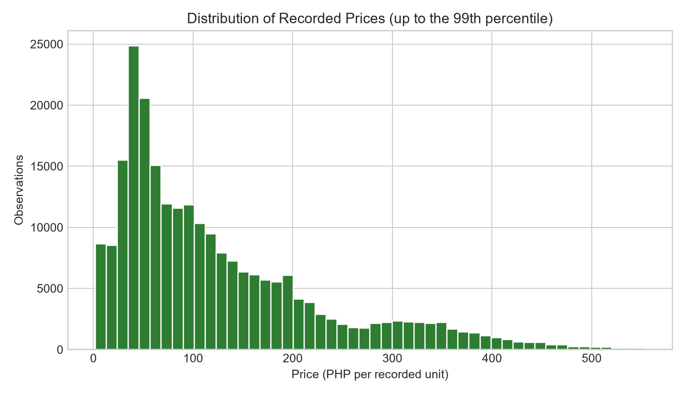
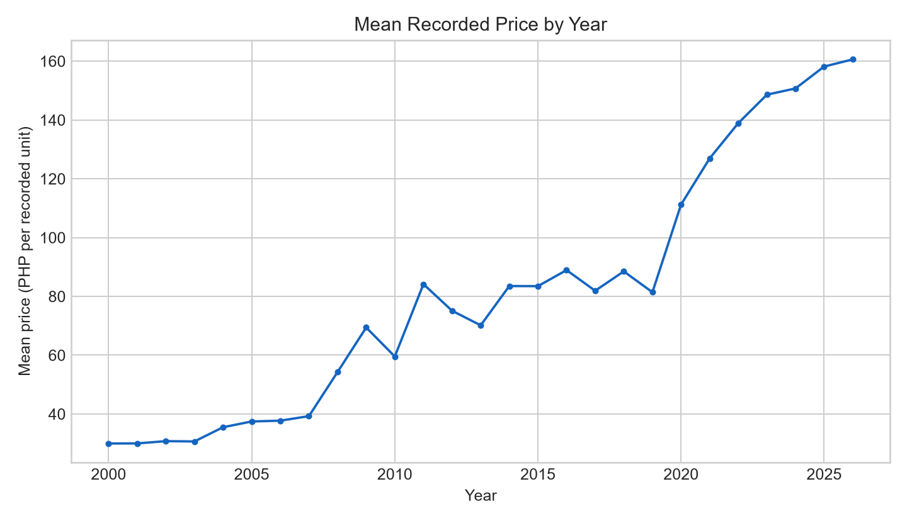
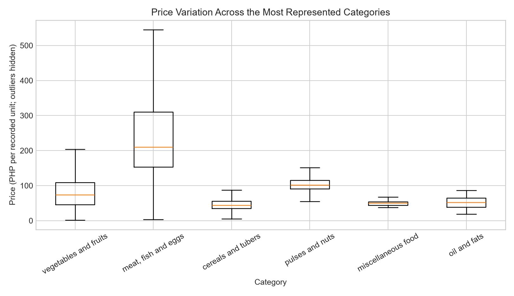
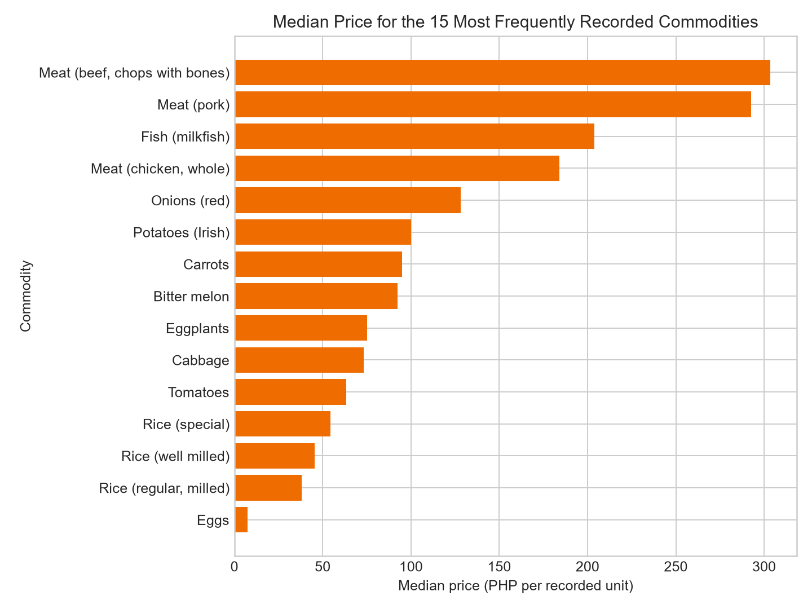
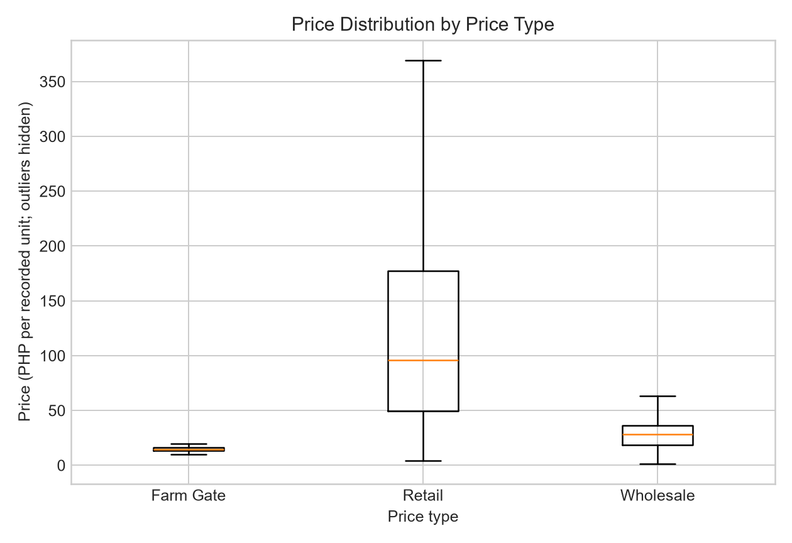
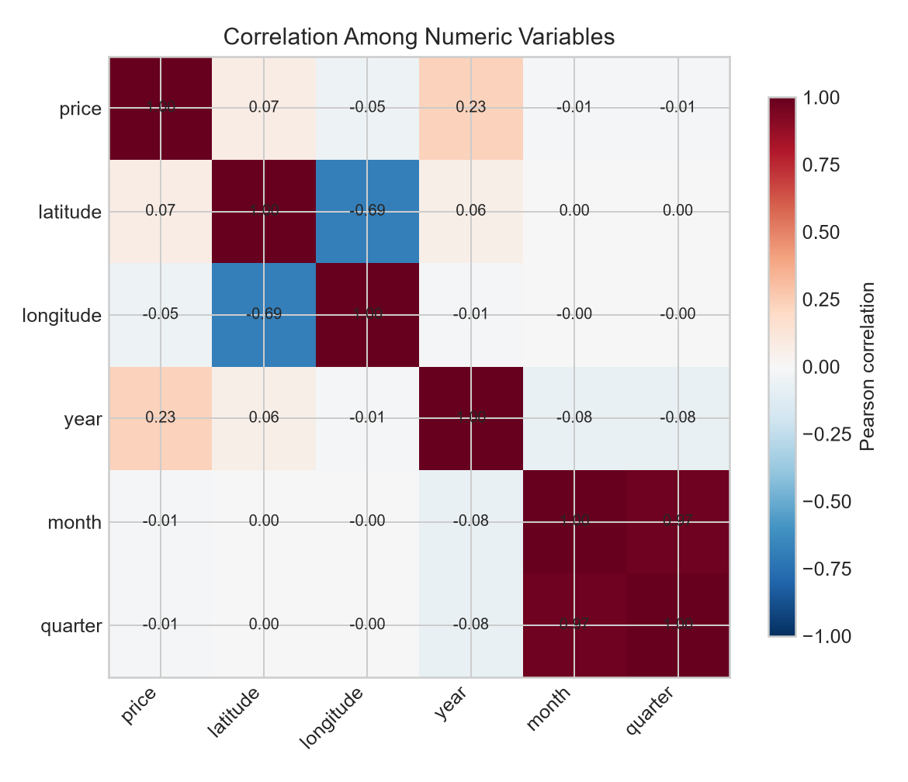
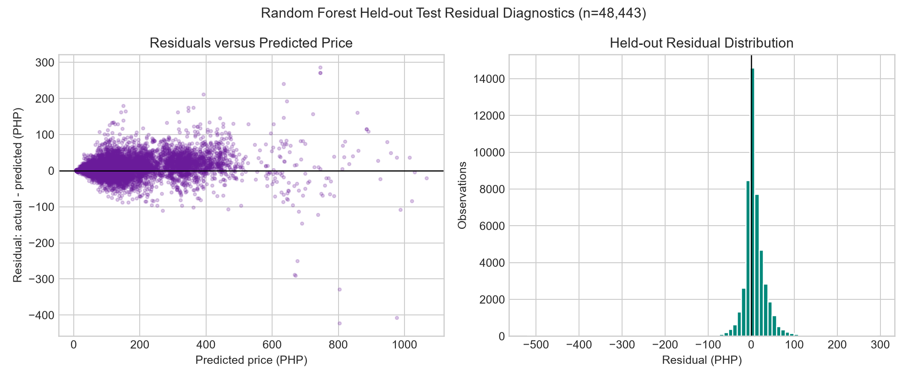

# Machine Learning-Based Philippine Agricultural Commodity Price Prediction Using Linear Regression, Random Forest, and Gradient Boosting

Martin B. Santiago  
Jarod Kyle C. Alde  
Adrian A. Dador  
John McRae M. Padayao  
*College of Computing and Information Technologies*  
*National University Philippines*  
*Manila, Philippines*

santiagomb@students.national-u.edu.ph  
aldejc@students.national-u.edu.ph  
dadoraa@students.national-u.edu.ph  
padayaojm@students.national-u.edu.ph

## Abstract

Agricultural commodity prices vary across locations, commodities, market levels, units, and time, making manual comparison difficult for farmers, consumers, traders, and analysts. This study developed an end-to-end traditional machine-learning system that estimates Philippine agricultural commodity prices from publicly available World Food Programme market records. The processed dataset contains 242,212 observations from January 2000 to August 2026, covering 17 first-level administrative areas, 79 second-level areas, 108 markets, and 73 commodities. Price in Philippine pesos per recorded unit was the regression target. A chronological 80:20 split produced 193,769 training observations and 48,443 held-out observations. Categorical features were one-hot encoded inside a reusable preprocessing pipeline, while numeric location and calendar features were passed through. Exactly three permitted regression algorithms—Linear Regression, Random Forest Regressor, and Gradient Boosting Regressor—were compared using five-fold time-series cross-validation with mean absolute error (MAE) as the primary metric. Random Forest obtained the lowest validation MAE of PHP 23.216, compared with PHP 26.146 for Gradient Boosting and PHP 29.153 for Linear Regression. The saved Random Forest pipeline achieved MAE = PHP 17.271, RMSE = PHP 27.946, and R² = 0.956 on the held-out partition. Commodity and category were the dominant aggregated feature groups. A Streamlit application loads the saved pipeline and provides monthly prediction and historical actual-versus-predicted views with validated inputs. The results demonstrate the practical value of nonlinear ensemble regression for heterogeneous market data, while also identifying limitations involving price-unit comparability, inflation, exogenous variables, uncertainty estimates, and evaluation documentation.

**Index Terms—** agricultural prices, gradient boosting, machine learning, Philippines, random forest, regression, Streamlit

## I. Introduction

### A. Background and Practical Problem

Food-price accessibility, affordability, and stability are central to Philippine food security. Galang found that food access and affordability remain uneven and that price conditions must be considered alongside supply [1]. Briones likewise showed that food-price changes and economic shocks influence household food and nutrient intake, making timely price information relevant to welfare and policy [2]. Earlier Philippine policy analysis emphasized that food-market interventions must balance price stability, producer incentives, and food security rather than treating low prices as an isolated objective [3].

The practical difficulty is that agricultural prices are not determined by commodity identity alone. They differ across regions, provinces, markets, sales levels, units, and seasons. The repository used in this study contains more than two hundred thousand Philippine market observations representing these interacting dimensions. A user who wants a plausible price for a selected commodity, market, price type, unit, and month would otherwise need to search a large historical table and reconcile inconsistent market coverage manually.

This study frames the task as supervised regression. The target is the recorded market price in Philippine pesos for the selected unit. Intended users include students and researchers exploring historical price behavior, market analysts needing a rapid reference estimate, and agricultural stakeholders comparing recorded prices across places and months. Machine learning is appropriate because the dataset contains high-cardinality categorical variables and nonlinear interactions that are difficult to represent using a single hand-written formula.

The study asks:

1. How do Philippine agricultural prices vary across time, commodity, category, market, unit, and price type?
2. Under a common chronological validation design, which of Linear Regression, Random Forest Regressor, and Gradient Boosting Regressor produces the lowest MAE?
3. Can the selected preprocessing-and-model pipeline be integrated into a usable Streamlit application without retraining at prediction time?

The principal objective is to build, compare, and document exactly three traditional regression algorithms, select the best model using time-aware validation, evaluate the saved pipeline on later observations, and expose it through a simple application. The scope is limited to records and variables present in the WFP-derived Philippine price dataset. It does not attempt causal inference, production-yield forecasting, automated trading, or a guarantee of future market prices.

### B. Philippine Related Literature

Philippine literature establishes why price analysis matters and which contextual factors a prediction system must not ignore. Briones examined the policy trade-off between rice self-sufficiency and food security, showing that market-price outcomes are inseparable from trade and self-sufficiency choices [4]. Tiongco and Francisco studied the relationship between food security and agricultural exports, illustrating how domestic outcomes sit within wider production and trade systems [5]. Intal, Cu, and Illescas analyzed rice prices and the National Food Authority and underscored the role of public institutions in price formation and stabilization [6]. These studies caution against interpreting a model’s output as a purely technological or policy-neutral quantity.

Yao, Shively, and Masters assessed interventions in the Philippine rice market and found that the effectiveness of market policy must be evaluated empirically rather than assumed [7]. Abrigo linked rice-price shocks with household breastfeeding decisions, demonstrating that commodity-price changes can produce consequences beyond the market itself [8]. These findings support the need for accessible price information while also showing why prediction error has human significance.

Recent Philippine macroeconomic work broadens the set of potential drivers. Armas, Asi, Mandap, and Moral reported macroeconomic responses to temperature shocks, indicating that climate-related variation can pass through to the wider economy [9]. Allon-Pineda, Ocampo, and Santos examined second-round and asymmetric inflation effects from oil and food-price shocks [10]. Together, the ten Philippine sources [1]–[10] indicate that prices reflect food security, public policy, trade, climate, inflation, and household behavior. The present system does not claim to encode all of those mechanisms; instead, it supplies a reproducible baseline based on observed market, product, geography, sales level, unit, and calendar information.

### C. International Related Literature

International literature provides both the data rationale and methodological basis for this work. The World Food Programme treats price monitoring as part of market and food-security analysis and publishes guidance on collecting prices for food-security programming [11]. The Humanitarian Data Exchange’s HAPI documentation describes the WFP food-price and market-monitor series as primarily monthly records whose schema includes market, commodity, unit, price flag, price type, and price [12]. Those fields correspond closely to the variables retained in this project.

Empirical forecasting studies consistently show that model performance depends on the data and comparison design. Paul *et al.* compared ARIMA, Random Forest, support-vector regression, generalized regression neural networks, and gradient boosting for brinjal prices in 17 Indian markets; machine-learning methods generally exceeded ARIMA, while the best learner varied by market [13]. Aulia and Pratama compared methods for milling-level rice-price data and reported stronger results for Random Forest than Gradient Boosting in their setting [14]. Zhao *et al.* proposed a TCN-XGBoost hybrid for agricultural market prices, showing that more complex temporal and ensemble representations may be useful when sufficient sequence information exists [15]. These studies support empirical comparison rather than assuming one universally superior method.

Hybrid approaches have also been developed for volatile prices. Ray *et al.* combined ARIMA, LSTM, and Random Forest-based lag selection for pulse-price indices and reported improvements over conventional alternatives [16]. Such results are informative, but neural and deep-learning methods were prohibited by the course specification for the present project. The study therefore uses only traditional, permitted regressors. Wu *et al.* reviewed 773 agricultural-price studies and identified data leakage, inconsistent test horizons, limited uncertainty treatment, and the need for multisource features as recurring challenges [17]. These points directly inform the present chronological split and the limitations reported later.

Other international studies show that agricultural-price series require both temporal and contextual reasoning. Ahumada and Cornejo studied forecasting for corn, soybeans, and wheat, demonstrating the value of model-based out-of-sample food-price forecasts [18]. Xiong, Li, and Bao combined seasonal-trend decomposition with an extreme learning machine for Chinese vegetable prices, illustrating the importance of seasonality [19]. Banerjee, Sinha, and Choudhury evaluated long- and short-term horticultural forecasting with LSTM networks, further demonstrating that forecast horizon and temporal structure affect performance [20]. Although those works motivate future sequence models, the current implementation deliberately remains within traditional ML requirements.

The three algorithms used here have well-established foundations. Random Forest reduces variance by aggregating decorrelated decision trees [21], while Gradient Boosting constructs an additive model by sequentially fitting weak learners to prior errors [22]. Bergmeir and Benítez showed why evaluation procedures for temporally ordered predictors require special care [23]. The current use of chronological splitting and `TimeSeriesSplit` follows that principle. The implementation uses scikit-learn pipelines so that transformations learned from training data are applied consistently during validation, testing, and deployment [24].

### D. Research Gap and Contribution

The reviewed Philippine sources explain why agricultural prices matter but do not provide a reproducible, locally deployable, multi-commodity prediction application built from the WFP Philippine records. International studies compare many sophisticated algorithms, but their datasets, commodities, countries, and deployment contexts differ. This project contributes a course-compliant traditional-ML baseline that:

- profiles a large Philippine multi-market price dataset;
- compares exactly three permitted regression algorithms under a shared preprocessing and time-series validation design;
- saves the complete preprocessing-and-model pipeline rather than only the estimator;
- reports both predictive performance and aggregated feature importance; and
- integrates the selected artifact into a Streamlit interface for prediction and historical comparison.

## II. Methods

### A. Research Design, Data Source, and Ethics

The study used a quantitative, applied machine-learning design. The source file is the public WFP Philippine food-price dataset distributed through humanitarian open-data channels [11], [12]. The repository preserves both the original CSV and a processed CSV. The unit of analysis is one reported price observation for a date, geographic location, market, commodity, unit, price flag, and price type.

The processed dataset contains 242,212 rows and 15 columns covering 15 January 2000 through 15 August 2026. It includes no personal identifiers, household records, or sensitive individual attributes. Accordingly, the study presents minimal direct privacy risk. Ethical use still requires attribution, preservation of the source record, and avoidance of claims that a model-generated estimate is an official price quotation. The final submission package should include an explicit source URL, retrieval date, and the applicable dataset license or permission statement; the current repository includes the data but not yet a complete source-and-license note.

### B. Variables and Target

The target variable is `price`, expressed in Philippine pesos per value of the associated `unit` field. The predictor set contains eight categorical and five numerical variables:

- Categorical: `admin1`, `admin2`, `market`, `category`, `commodity`, `unit`, `priceflag`, and `pricetype`.
- Numerical: `latitude`, `longitude`, `year`, `month`, and `quarter`.

The raw `date` field establishes chronological order and is decomposed into calendar features; it is not passed directly to the estimator. The dataset contains 17 `admin1` values, 79 `admin2` values, 108 markets, 73 commodities, three recorded unit labels (`KG`, `Unit`, and `750ML`), three price-flag combinations, and three price types (`Retail`, `Wholesale`, and `Farm Gate`). Because units are heterogeneous, `unit` is retained as a predictor and pooled price summaries are interpreted cautiously.

### C. Exploratory Data Analysis

EDA examined dimensions, data types, value counts, summary statistics, missingness, duplicate rows, impossible nonpositive prices, univariate target shape, temporal movement, category and commodity differences, price-type differences, geographic correlations, and extreme observations. Seven reproducible evidence figures are included with this paper. Each figure supports a modeling decision:

1. Target distribution identifies skew and extreme prices, motivating MAE as the primary metric.
2. Yearly averages show temporal movement, requiring a chronological rather than random split.
3. Category boxplots show strong between-category heterogeneity.
4. Commodity medians show that commodity identity is likely predictive.
5. Price-type boxplots justify retaining market level.
6. Numeric correlations test whether location coordinates alone explain price.
7. Residual diagnostics evaluate the selected model’s errors.

### D. Data Preparation and Leakage Control

The processed table is sorted by `date`. Data-quality checks found zero missing values, zero duplicate rows, and zero prices less than or equal to zero, so no imputation or record deletion was applied. High prices were retained because inspection linked many extremes to expensive commodity groups rather than obvious encoding errors. Removing them without external verification could erase legitimate market variation.

Categorical values are transformed with `OneHotEncoder(handle_unknown='ignore')`, allowing deployment to avoid failure when a supported field contains a category absent from a particular fitted fold. Numerical values pass through unchanged. Both transformations are held in a `ColumnTransformer`, which is then joined to the estimator in a scikit-learn `Pipeline` [24]. This design ensures that encoding is fitted within the training process and that the deployed model receives exactly the same transformation logic.

### E. Split and Validation Strategy

After chronological sorting, the first 80% of rows (193,769 observations) form the training partition and the last 20% (48,443 observations) form the held-out partition. The training observations span January 2000 to the row-level boundary on 15 February 2025; the held-out portion begins at that boundary and ends on 15 August 2026. Because multiple observations share a date, the row-level 80% cutoff divides records from 15 February 2025 across the two partitions. A date-group boundary would be preferable in a future revision to eliminate same-date overlap.

Model selection within the training partition uses five-fold `TimeSeriesSplit`, preserving temporal order. All three algorithms use the same feature set, preprocessing logic, folds, and primary scoring rule. MAE is the primary metric because it expresses typical absolute error directly in Philippine pesos and is less dominated by extreme prices than squared-error criteria. RMSE and R² are supporting metrics.

The metrics are:

\[
MAE = \frac{1}{n}\sum_{i=1}^{n}|y_i-\hat{y}_i|,
\]

\[
RMSE = \sqrt{\frac{1}{n}\sum_{i=1}^{n}(y_i-\hat{y}_i)^2},
\]

and

\[
R^2 = 1-\frac{\sum_i(y_i-\hat{y}_i)^2}{\sum_i(y_i-\bar{y})^2}.
\]

### F. Algorithms and Hyperparameter Tuning

Exactly three permitted traditional regression algorithms are compared:

1. **Linear Regression** provides an interpretable additive baseline after one-hot encoding.
2. **Random Forest Regressor** models nonlinear interactions through an ensemble of randomized trees [21].
3. **Gradient Boosting Regressor** sequentially corrects residual errors with shallow trees [22].

`GridSearchCV` uses negative MAE scoring with the five time-series folds. The Random Forest grid compares 50 and 100 trees, maximum depth of `None` or 20, and `max_features='sqrt'`. Its selected setting is 100 trees, unlimited depth, and square-root feature sampling. The Gradient Boosting grid uses 100 estimators, learning rates of 0.05 and 0.10, and tree depths of 3 and 5. Its selected setting is 100 estimators, learning rate 0.10, and maximum depth 5. Linear Regression is fitted without a hyperparameter grid.

### G. Saved Pipeline and Application

The selected pipeline is serialized as `models/best_model.joblib`. The Streamlit application loads this artifact with resource caching and loads the processed data with data caching. It offers two user workflows:

- **Monthly Forecast:** the user selects geographic, market, commodity, unit, price-flag, price-type, and calendar values; the application builds a one-row input with the required 13 features and returns the Random Forest estimate.
- **Historical Comparison:** the application filters historical records, produces model estimates for matching observations, and plots actual and predicted series on the same Plotly chart. Metrics are computed only where both actual and predicted values exist.

The application exposes structured selectors derived from the available data, identifies the model, labels values in PHP per selected unit, handles empty result sets, and permits result download. It does not retrain or overwrite the pipeline during use.

## III. Results

### A. Data Quality and Descriptive Findings

Table I summarizes the processed dataset. No missing, duplicate, or nonpositive-price records were found. The mean price is PHP 131.55, the median is PHP 93.75, and the standard deviation is PHP 119.38. The gap between mean and median, together with a maximum of PHP 1,216.67, indicates a right-skewed target. The 95th and 99th percentiles are PHP 366.67 and PHP 553.22, respectively.

**Table I. Processed dataset profile**

| Item | Result |
|---|---:|
| Observations | 242,212 |
| Variables | 15 |
| Date coverage | 2000-01-15 to 2026-08-15 |
| Missing values | 0 |
| Duplicate rows | 0 |
| Price ≤ 0 | 0 |
| Mean price | PHP 131.55 |
| Median price | PHP 93.75 |
| Standard deviation | PHP 119.38 |
| Minimum–maximum | PHP 1.60–1,216.67 |
| 95th / 99th percentile | PHP 366.67 / 553.22 |



**Fig. 1.** Price distribution through the 99th percentile. The visible right tail supports the use of MAE as the primary selection metric. Values above the 99th percentile were retained in modeling and omitted from this figure only for readability.



**Fig. 2.** Mean recorded price by year. The temporal movement shows why random shuffling would produce an unrealistic evaluation and why calendar features may contain signal.

Unit-level summaries reinforce the need to treat unit as a feature. `KG` records have a mean of PHP 135.83 and median of PHP 97.50, while `Unit` records average PHP 7.79 and `750ML` records average PHP 53.45. These values cannot be interpreted as directly interchangeable quantities.



**Fig. 3.** Price variation across the eight most represented categories. Different centers and spreads support nonlinear category interactions.



**Fig. 4.** Median price for the 15 most frequently recorded commodities. Commodity identity produces substantial practical separation and was retained during modeling.



**Fig. 5.** Price distribution by Farm Gate, Retail, and Wholesale type. Market level changes both center and variability.



**Fig. 6.** Pearson correlation among numeric variables. The direct correlations of price with latitude (approximately 0.073) and longitude (approximately −0.049) are weak, suggesting that coordinates alone cannot explain price; categorical geography and market context remain necessary.

The EDA therefore led to five decisions: retain categorical market and product descriptors; retain unit and price type; keep legitimate high-value observations; use a nonlinear model candidate; and preserve temporal order during evaluation.

### B. Cross-Validation Comparison

Table II presents the mean five-fold time-series cross-validation MAE reported by the modeling notebook. Random Forest achieved the smallest error, improving on Linear Regression by PHP 5.937 (20.4%) and on Gradient Boosting by PHP 2.930 (11.2%). This result selected Random Forest for final pipeline serialization.

**Table II. Five-fold time-series validation results**

| Algorithm | Mean validation MAE (PHP) | Rank |
|---|---:|---:|
| Random Forest Regressor | **23.216** | **1** |
| Gradient Boosting Regressor | 26.146 | 2 |
| Linear Regression | 29.153 | 3 |

The current notebook records the fold mean but not the standard deviation or individual fold scores. Consequently, validation variability cannot yet be reported and should be exported before final submission.

### C. Held-Out Performance and Model Selection

The model-development notebook also contains a three-model held-out comparison (Table III). These values show the same ranking, but because the held-out partition was inspected for all three algorithms, they should not be represented as a test set viewed only once after final selection. This is an evaluation-documentation limitation that must be disclosed.

**Table III. Recorded held-out comparison from model development**

| Algorithm | MAE (PHP) | RMSE (PHP) | R² |
|---|---:|---:|---:|
| Linear Regression | 30.958 | 47.818 | 0.872 |
| Random Forest Regressor | **17.312** | **27.868** | **0.957** |
| Gradient Boosting Regressor | 30.530 | 43.837 | 0.892 |

A read-only reproduction using the current processed dataset and saved Random Forest pipeline yielded the results in Table IV. No fitting or artifact saving occurred during this check.

**Table IV. Reproduced saved-pipeline results on 48,443 later observations**

| Metric | Result |
|---|---:|
| MAE | PHP 17.271 |
| RMSE | PHP 27.946 |
| R² | 0.956 |
| Mean residual (actual − predicted) | PHP 7.746 |
| Median residual | PHP 3.667 |
| Residual standard deviation | PHP 26.852 |
| Predictions within ±PHP 10 | 49.24% |
| Predictions within ±PHP 25 | 77.10% |
| Predictions within ±PHP 50 | 93.58% |



**Fig. 7.** Residual-versus-prediction and residual-distribution diagnostics for the saved Random Forest pipeline. Most errors cluster around zero, but the positive mean and median show mild underprediction on average. The wider residual range at higher predicted prices and extreme residuals (minimum −PHP 521.91; maximum PHP 292.53) show that expensive or unusual observations remain difficult.

Random Forest was selected because it produced the lowest validation MAE, captured interactions unavailable to the additive linear baseline, exceeded the tested Gradient Boosting configuration, remained a permitted traditional method, and could be serialized with preprocessing for practical deployment. Its main trade-offs are a large artifact (approximately 1.67 GB), slower loading than Linear Regression, and less direct coefficient-level interpretability.

### D. Feature Importance

The fitted pipeline expands categorical fields into 297 encoded features. Aggregating tree importances back to their source columns gives Table V.

**Table V. Aggregated Random Forest feature importance**

| Feature group | Importance (%) |
|---|---:|
| Commodity | 47.767 |
| Category | 30.756 |
| Unit | 5.741 |
| Year | 5.718 |
| Market | 2.427 |
| Admin2 | 1.939 |
| Admin1 | 1.265 |
| Latitude | 1.193 |
| Month | 1.024 |
| Longitude | 0.858 |
| Price type | 0.774 |
| Quarter | 0.448 |
| Price flag | 0.090 |

Commodity and category jointly account for 78.52% of impurity-based importance, which agrees with the EDA. Importance is associative, not causal, and can be biased toward variables with many possible splits. It should therefore be used as an explanatory diagnostic rather than a policy-effect estimate.

### E. Application Evidence

Code inspection and local execution confirm that the application loads the saved pipeline, reads the processed data, constructs the expected 13-feature input, predicts without retraining, and displays historical actual-versus-predicted values on one chart. Table VI maps application requirements to current evidence.

**Table VI. Application requirement status**

| Requirement | Current evidence | Status |
|---|---|---|
| Load saved model and preprocessing | Cached `best_model.joblib` pipeline | Met locally |
| Practical validated inputs | Cascading selectors and calendar controls | Met locally |
| Clear output and units | PHP value and selected-unit labels | Met locally |
| Invalid or empty input handling | User-facing warning/error paths | Met in code |
| Historical comparison | Actual and Random Forest series on one Plotly chart | Met locally |
| Clean-environment dependencies | `requirements.txt` is present | Present; clean install still needs recorded verification |
| Public deployed URL | No URL is supplied in the repository | Not yet met |
| Application screenshots | No screenshots are present in `documentation/` | Not yet met |

## IV. Discussion

### A. Interpretation of Model Performance

The results answer the main research question: among the three tested traditional algorithms, Random Forest provides the best validation performance for this dataset. The result is consistent with the model’s ability to represent nonlinear interactions among commodity, category, unit, geography, market, price type, and time. Linear Regression treats encoded effects additively unless interaction terms are explicitly created, which limits its ability to capture market-specific commodity behavior. Gradient Boosting can model nonlinearity, but the tested grid may have been too narrow for the diversity and scale of the data, or its sequential error correction may have been more affected by heterogeneous extremes.

The model’s R² of approximately 0.956 indicates that it explains a large share of variation within the evaluated records, but it does not mean that individual future prices are correct 95.6% of the time. MAE gives the more practical interpretation: the typical absolute error is about PHP 17.27 per recorded unit. The RMSE is substantially higher than MAE because large misses receive greater weight. Residual analysis confirms mild systematic underprediction and a small number of large errors. Users should therefore treat the output as a reference estimate, especially for high-priced commodities or market-unit combinations with sparse history.

The importance results agree with both domain intuition and prior literature. Commodity and category dominate because price scales differ greatly across food groups. Unit is also essential because PHP per kilogram, per item, and per 750 mL container are not directly comparable. Year captures long-run movement, while month and quarter capture only part of seasonality. The weak direct coordinate correlations do not imply geography is irrelevant; rather, market and administrative categories represent localized context more effectively than a simple linear latitude or longitude relationship.

### B. Relationship to Prior Studies

The advantage of Random Forest in this project is compatible with Aulia and Pratama’s rice-price comparison [14] and with Paul *et al.*, who found Random Forest competitive with the strongest learner in several markets [13]. It should not be generalized as proof that Random Forest is universally best. Zhao *et al.* [15], Ray *et al.* [16], Xiong *et al.* [19], and Banerjee *et al.* [20] demonstrate that hybrid or sequence-aware methods can improve performance under different data and objectives. Those methods are outside the present course constraints and would also require a more explicit lagged forecasting design.

The Philippine literature also explains why omitted variables matter. Policy interventions [6], [7], trade conditions [4], [5], temperature shocks [9], and broader inflation transmission [10] may change prices in ways not represented by location and calendar variables. The model may partially absorb recurring historical patterns, but it cannot identify or anticipate an unseen policy shock merely from commodity and month.

### C. Practical Value and Trade-offs

The Streamlit interface converts a large table and a complex preprocessing pipeline into a repeatable interaction. It reduces the risk that users supply columns in the wrong order or forget encoding. Historical overlays also let users compare estimates with recorded observations rather than seeing an isolated number. These features make the system useful for demonstration, exploratory analysis, and decision support.

The application is not an official market bulletin. It provides point estimates without a prediction interval, and the term “forecast” should be interpreted narrowly: the estimator predicts price from a requested calendar and market configuration; it is not a recursively fitted univariate time-series model. A future user could select a calendar value outside the reliable training range, so the interface should display the supported date range and either block or prominently warn about extrapolation.

### D. Limitations and Validity Threats

The most important limitations are:

1. **Test chronology and documentation.** The notebook reports held-out metrics for all three algorithms before the final saved-pipeline validation. This weakens the claim that the test partition was untouched until after selection. A final protocol should select and tune entirely inside training data, preserve a genuinely unseen date block, and record that sequence.
2. **Same-date split boundary.** Multiple observations from 15 February 2025 appear on both sides of the row-level 80:20 cutoff. Splitting at a unique-date boundary would provide stronger temporal separation.
3. **Missing fold variability.** Only mean cross-validation MAE is stored; fold scores and standard deviation must be reported for full compliance.
4. **Heterogeneous measurement units.** Although unit is modeled, pooled metrics combine price errors from KG, Unit, and 750ML records. Unit-stratified metrics would be more interpretable.
5. **No inflation adjustment.** Nominal pesos across 2000–2026 are compared. Year captures trend but does not replace a consumer-price deflator.
6. **No lagged price or exogenous drivers.** The feature set excludes recent price lags, rainfall, extreme weather, production volume, fuel costs, trade flows, policy events, and inflation indices.
7. **Coverage and reporting bias.** Public market observations may be uneven across dates, markets, and commodities; the model learns the reporting process as well as price behavior.
8. **Point predictions only.** Random Forest outputs are presented without calibrated prediction intervals.
9. **Artifact size and maintainability.** The serialized pipeline is approximately 1.67 GB, affecting startup time and hosting feasibility.
10. **Submission incompleteness.** A public deployment URL, complete technical documentation, source/license note, screenshots, contribution confirmations, signed authorship declaration, and final DOCX/PDF are not yet present.

These limitations do not invalidate the reported local results, but they constrain generalization and must be resolved or acknowledged before the system is described as a fully compliant final submission.

## V. Conclusion and Recommendations

This study developed and evaluated a traditional machine-learning system for Philippine agricultural commodity-price prediction. EDA showed a large, right-skewed, heterogeneous dataset in which commodity, category, unit, market level, geography, and time all matter. Under a shared five-fold time-series validation design, Random Forest obtained the lowest mean MAE (PHP 23.216), ahead of Gradient Boosting (PHP 26.146) and Linear Regression (PHP 29.153). The saved Random Forest pipeline reproduced MAE = PHP 17.271, RMSE = PHP 27.946, and R² = 0.956 on 48,443 later observations. Its preprocessing and estimator are integrated into a Streamlit application with monthly prediction and historical comparison workflows.

The project therefore meets the core technical intent of an end-to-end traditional regression system: it uses a legitimate public dataset, conducts EDA, compares exactly three permitted algorithms, preserves chronological order, saves a complete pipeline, and provides a usable local application. It does not yet meet every final-deliverable requirement. In particular, evaluation chronology must be clarified, fold variability must be exported, and the public deployment and documentation package remain incomplete.

Before submission, the group should:

1. rerun or restructure evaluation so final model selection occurs before access to a genuinely unseen date-block test set;
2. split on a unique-date boundary and save all fold MAE values, mean, and standard deviation;
3. report metrics by unit, commodity support, price type, and price range;
4. add lagged prices and evaluate weather, inflation, fuel, production, and policy-event variables where ethically and legally available;
5. add calibrated prediction intervals and extrapolation warnings;
6. compress or distill the model if hosting limits make the 1.67-GB artifact impractical;
7. finish the README, data-source/license note, user guide, troubleshooting notes, screenshots, and clean-environment test;
8. deploy the Streamlit application and record its URL;
9. have all members confirm the contribution record and sign the ownership/authorship declaration; and
10. convert the final IEEE-formatted manuscript to DOCX and PDF and check every in-text citation against the reference list.

## VI. References

[1] I. M. R. Galang, “Is food supply accessible, affordable, and stable? The state of food security in the Philippines,” Philippine Institute for Development Studies, Discussion Paper 2022-21, 2022, doi: 10.62986/dp2022.21.

[2] R. M. Briones, “Food and nutrient intake response to food prices and government programs: Implications for the recent economic shocks,” Philippine Institute for Development Studies, Discussion Paper 2022-44, 2022, doi: 10.62986/dp2022.44.

[3] C. C. David, “Food policy: Its role in price stability and food security,” Philippine Institute for Development Studies, Discussion Paper 1997-11, 1997, doi: 10.62986/dp1997.11.

[4] R. M. Briones, “Food (in)security and the price of rice self-sufficiency,” Philippine Institute for Development Studies, Discussion Paper 2016-50, 2016, doi: 10.62986/dp2016.50.

[5] M. M. Tiongco and K. A. Francisco, “Philippines: Food security versus agricultural exports?” Philippine Institute for Development Studies, Discussion Paper 2011-35, 2011, doi: 10.62986/dp2011.35.

[6] P. S. Intal, Jr., L. F. Cu, and J. A. Illescas, “Rice prices and the National Food Authority,” Philippine Institute for Development Studies, Discussion Paper 2012-27, 2012, doi: 10.62986/dp2012.27.

[7] R. T. Yao, G. E. Shively, and W. A. Masters, “How successful are government interventions in food markets? Insights from the Philippine rice market,” *Philippine Journal of Development*, vol. 34, no. 1, pp. 35–59, 2007, doi: 10.62986/pjd2007.34.1b.

[8] M. R. M. Abrigo, “Who weans with commodity price shocks? Rice prices and breastfeeding in the Philippines,” Philippine Institute for Development Studies, Discussion Paper 2016-28, 2016, doi: 10.62986/dp2016.28.

[9] J. C. A. Armas, R. J. L. Asi, D. R. L. Mandap, and G. R. L. Moral, “Macroeconomic effects of temperature shocks in the Philippines: Evidence from impulse responses by local projections,” Bangko Sentral ng Pilipinas, BSP Discussion Paper 2024-02, Mar. 2024. [Online]. Available: https://www.bsp.gov.ph/Sites/researchsite/Publications/BSP-Discussion-Papers/DP202402.pdf

[10] J. C. S. Allon-Pineda, J. C. G. Ocampo, and E. R. D. Santos, “Second-round effects and asymmetry in oil and food price shocks to inflation,” Bangko Sentral ng Pilipinas, BSP Discussion Paper 2025-06, Apr. 2025. [Online]. Available: https://www.bsp.gov.ph/Sites/researchsite/Publications/BSP-Discussion-Papers/DP202506.pdf

[11] World Food Programme, “Market analysis guidelines,” Mar. 31, 2017. [Online]. Available: https://www.wfp.org/publications/market-analysis-guidelines

[12] Humanitarian Data Exchange, “Food prices and market monitor,” *HDX Humanitarian API Documentation*. [Online]. Available: https://hdx-hapi.readthedocs.io/en/latest/data_usage_guides/food_security_nutrition_and_poverty/

[13] R. K. Paul, M. Yeasin, P. Kumar, P. Kumar, M. Balasubramanian, H. S. Roy, A. K. Paul, and A. Gupta, “Machine learning techniques for forecasting agricultural prices: A case of brinjal in Odisha, India,” *PLOS ONE*, vol. 17, no. 7, Art. no. e0270553, 2022, doi: 10.1371/journal.pone.0270553.

[14] I. D. Aulia and I. Pratama, “Analysis of forecasting methods on rice price data at milling level according to quality,” *Edu Komputika Journal*, vol. 11, no. 1, pp. 1–10, 2024, doi: 10.15294/edukom.v11i1.4763.

[15] T. Zhao, G. Chen, S. Suraphee, T. Phoophiwfa, and P. Busababodhin, “A hybrid TCN-XGBoost model for agricultural product market price forecasting,” *PLOS ONE*, vol. 20, no. 5, Art. no. e0322496, 2025, doi: 10.1371/journal.pone.0322496.

[16] S. Ray, A. Lama, P. Mishra, T. Biswas, S. S. Das, and B. Gurung, “An ARIMA-LSTM model for predicting volatile agricultural price series with random forest technique,” *Applied Soft Computing*, vol. 149, Art. no. 110939, 2023, doi: 10.1016/j.asoc.2023.110939.

[17] B. Wu, J. Wang, Q. Li, D. Fu, and L. Wang, “A comprehensive review for agricultural product prices forecasting: Architectural diversity and open challenges,” *Expert Systems*, vol. 43, no. 5, Art. no. e70254, 2026, doi: 10.1111/exsy.70254.

[18] H. Ahumada and M. Cornejo, “Forecasting food prices: The case of corn, soybeans and wheat,” *International Journal of Forecasting*, vol. 32, no. 3, pp. 838–848, 2016, doi: 10.1016/j.ijforecast.2016.01.002.

[19] T. Xiong, C. Li, and Y. Bao, “Seasonal forecasting of agricultural commodity price using a hybrid STL and ELM method: Evidence from the vegetable market in China,” *Neurocomputing*, vol. 275, pp. 2831–2844, 2018, doi: 10.1016/j.neucom.2017.11.053.

[20] T. Banerjee, S. Sinha, and P. Choudhury, “Long term and short term forecasting of horticultural produce based on the LSTM network model,” *Applied Intelligence*, vol. 52, pp. 9117–9147, 2022, doi: 10.1007/s10489-021-02845-x.

[21] L. Breiman, “Random forests,” *Machine Learning*, vol. 45, pp. 5–32, 2001, doi: 10.1023/A:1010933404324.

[22] J. H. Friedman, “Greedy function approximation: A gradient boosting machine,” *The Annals of Statistics*, vol. 29, no. 5, pp. 1189–1232, 2001, doi: 10.1214/aos/1013203451.

[23] C. Bergmeir and J. M. Benítez, “On the use of cross-validation for time series predictor evaluation,” *Information Sciences*, vol. 191, pp. 192–213, 2012, doi: 10.1016/j.ins.2011.12.028.

[24] F. Pedregosa *et al.*, “Scikit-learn: Machine learning in Python,” *Journal of Machine Learning Research*, vol. 12, pp. 2825–2830, 2011. [Online]. Available: https://jmlr.org/papers/v12/pedregosa11a.html

## VII. Appendices

### Appendix A. Data Dictionary

| Field | Type | Role | Description / unit |
|---|---|---|---|
| `date` | Date | Ordering | Observation date; used for chronological sorting |
| `admin1` | Categorical | Predictor | First-level Philippine administrative area |
| `admin2` | Categorical | Predictor | Second-level administrative area |
| `market` | Categorical | Predictor | Reporting market |
| `latitude` | Numeric | Predictor | Market latitude in decimal degrees |
| `longitude` | Numeric | Predictor | Market longitude in decimal degrees |
| `category` | Categorical | Predictor | Broad commodity group |
| `commodity` | Categorical | Predictor | Specific commodity description |
| `unit` | Categorical | Predictor | Recorded unit (`KG`, `Unit`, or `750ML`) |
| `priceflag` | Categorical | Predictor | Source flag such as actual or aggregate |
| `pricetype` | Categorical | Predictor | Retail, Wholesale, or Farm Gate |
| `price` | Numeric | Target | Recorded nominal Philippine pesos per unit |
| `year` | Integer | Predictor | Calendar year derived from `date` |
| `month` | Integer | Predictor | Calendar month, 1–12 |
| `quarter` | Integer | Predictor | Calendar quarter, 1–4 |

### Appendix B. Example Application Input and Output

**Illustrative valid input schema**

```text
admin1: selected supported region
admin2: selected supported province/area
market: selected market
category: selected commodity category
commodity: selected commodity
unit: KG, Unit, or 750ML
priceflag: selected source flag
pricetype: Retail, Wholesale, or Farm Gate
latitude, longitude: associated market coordinates
year: requested year
month: 1-12
quarter: derived from month
```

**Output:** one Random Forest price estimate in PHP per selected unit, accompanied by model identification and context. In Historical Comparison mode, the output includes a table, downloadable CSV, summary metrics over matched records, and an Actual-versus-Random-Forest Plotly chart. Exact numeric output depends on the selected input and must be captured from the running application for the final screenshot appendix.

### Appendix C. Reproducibility Map

| Evidence | Repository location |
|---|---|
| Raw data | `data/original/wfp_food_prices_phl.csv` |
| Processed data | `data/processed/wfp_food_prices_phl_processed.csv` |
| Preprocessing notebook | `notebooks/00_preprocessing.ipynb` |
| EDA notebook | `notebooks/01_eda.ipynb` |
| Model comparison | `notebooks/02_modeling.ipynb` |
| Saved-model validation | `notebooks/03_model_validation.ipynb` |
| Feature importance | `notebooks/04_feature_importance.ipynb` |
| Saved pipeline | `models/best_model.joblib` |
| Streamlit application | `app/app.py` |
| Reusable application logic | `src/` |
| Dependencies | `requirements.txt` |
| Paper figures | `paper/figures/` |

### Appendix D. Group Contribution Record

The following record must be completed from the group’s actual work history and confirmed by every member. Responsibilities have intentionally not been invented.

| Member | Assigned responsibilities | Actual contributions | Member confirmation / date |
|---|---|---|---|
| Martin B. Santiago | To be completed by the group | To be completed by the member | Pending |
| Jarod Kyle C. Alde | To be completed by the group | To be completed by the member | Pending |
| Adrian A. Dador | To be completed by the group | To be completed by the member | Pending |
| John McRae M. Padayao | To be completed by the group | To be completed by the member | Pending |

### Appendix E. Ownership and Authorship Declaration

| Project Information | Details |
|---|---|
| Project title | Machine Learning-Based Philippine Agricultural Commodity Price Prediction Using Linear Regression, Random Forest, and Gradient Boosting |
| Course and section | To be supplied by the group |
| Group name or number | To be supplied by the group |
| Date submitted | To be supplied at submission |

We, Dr. Armida P. Salazar as the course instructor and the undersigned student group members, jointly declare that we are the owners and authors of the submitted project output identified above. The project output includes the application, source code, trained model and saved pipeline, exploratory data analysis, visualizations, technical documentation, research paper, and original materials produced specifically for this course project.

We affirm that the submitted work accurately represents our documented contributions and that all external datasets, software libraries, code, models, frameworks, images, publications, and other third-party materials have been properly cited, licensed, or acknowledged using IEEE citation format where applicable. This declaration does not transfer or claim ownership of pre-existing third-party or institutional materials and remains subject to applicable National University policies, intellectual-property rules, licenses, and Philippine law.

| Name and role | Signature | Date |
|---|---|---|
| Dr. Armida P. Salazar, Course Instructor |  |  |
| Martin B. Santiago, Student Group Member |  |  |
| Jarod Kyle C. Alde, Student Group Member |  |  |
| Adrian A. Dador, Student Group Member |  |  |
| John McRae M. Padayao, Student Group Member |  |  |

### Appendix F. Final Compliance Check

| Requirement | Status at time of paper revision |
|---|---|
| Clear regression target and intended users | Complete |
| Legitimate public dataset included | Complete |
| Dataset source/license note | Source identified; standalone license note still required |
| At least five meaningful EDA figures | Complete; six EDA figures included |
| Exactly three permitted algorithms | Complete |
| Common preprocessing and five-fold time-series validation | Complete |
| Fold mean and variability | Mean complete; variability not yet exported |
| Chronological 80:20 split | Complete at row level; unique-date boundary recommended |
| Truly untouched final test | Not fully demonstrated; protocol revision recommended |
| MAE, RMSE, R², and residual analysis | Complete for the saved Random Forest pipeline |
| Saved pipeline used by Streamlit | Complete locally |
| Valid, invalid, and boundary UI test record | Code handling present; formal test log still required |
| Public deployment URL | Missing |
| Complete README and technical documentation | Incomplete |
| Contribution record confirmed | Pending member confirmation |
| Signed ownership/authorship declaration | Pending signatures |
| IEEE-formatted DOCX and PDF | Pending export |
